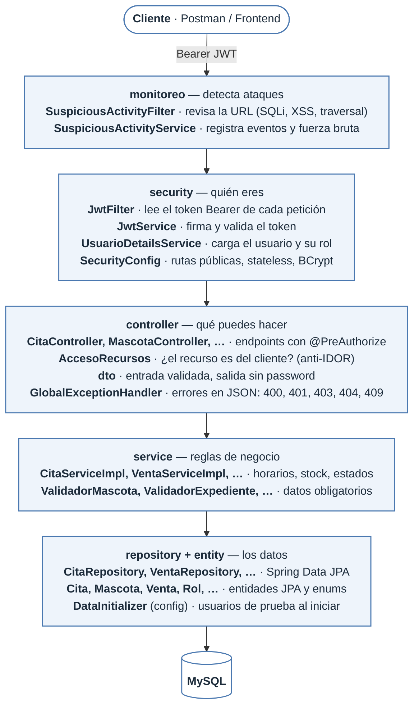

# Clínica PetSalud · Backend 

API REST para citas, expedientes médicos, mascotas y ventas. Autentica con **JWT**, autoriza por **rol** (CLIENTE, VETERINARIO, ADMIN) y por **dueño del recurso**, y valida sus reglas con **177 pruebas automatizadas**.

**Tecnologías:** Java 17 · Spring Boot 3.3 · Spring Security · JWT · JPA · MySQL · JUnit 5 · Mockito · JaCoCo

---

## Arquitectura y estructura del proyecto

Cada capa muestra sus clases en `src/main/java/com/petsalud/backendpetsalud/` y lo que hace cada una. Una petición recorre las capas de arriba hacia abajo.



Otros archivos:

| Ruta | Para qué sirve |
|---|---|
| `src/test/java/` | Pruebas, en los mismos paquetes que `src/main` |
| `src/test/resources/application.properties` | Configuración de pruebas con H2 en memoria |
| `pruebas/pruebas-api.sh` | Pruebas de la API con curl |
| `docker-compose.yml` | MySQL para ejecutar la aplicación |
| `.env.example` | Plantilla de las variables de entorno |

## Reglas de negocio

| Entidad | Reglas |
|---|---|
|  **Cita** |  Estados: AGENDADA → COMPLETADA (al terminar la consulta) o CANCELADA<br> Fecha futura, con hasta 30 días de plazo<br> El veterinario debe tener rol VETERINARIO<br> Dura 30 min: no puede cruzarse con otra del mismo veterinario (409)<br> Máximo 8 citas por veterinario al día (409)<br> Cancelar no la borra: queda en el historial |
|  **Expediente médico** | Datos obligatorios `ValidadorExpediente`: descripción, diagnóstico y tratamiento obligatorios<br> Lo firma el veterinario que inició sesión (su id sale del token)<br> Mascota o veterinario inexistente → 404 |
|  **Mascota** | Datos obligatorios `ValidadorMascota`: nombre, especie, raza, fecha de nacimiento y sexo obligatorios<br> La fecha de nacimiento no puede ser futura<br> La edad se calcula sola desde la fecha de nacimiento<br> El dueño sale del token o de la URL, nunca del JSON |
|  **Venta** | Datos obligatorios`ValidadorUsuario`: el comprador debe ser CLIENTE con datos completos<br> Revisa el stock de todos los productos antes de descontar<br> Un producto repetido se cobra y descuenta por unidad |

## Ejecución

Requisitos: Java 17+ y Docker.

```bash
cp .env.example .env     # completa los valores (el .env no se sube)
docker compose up -d     # levanta MySQL
./mvnw spring-boot:run
```

| Variable | Uso |
|---|---|
| `MYSQL_USERNAME` / `MYSQL_PASSWORD` | Credenciales de MySQL |
| `JWT_SECRET_BASE64` | Clave de firma JWT (`openssl rand -base64 32`) |
| `SEED_PASSWORD` | Contraseña de los usuarios de prueba |

Usuarios de prueba: `cliente@petsalud.test` (CLIENTE) · `empleado@petsalud.test` (VETERINARIO) · `gerente@petsalud.test` (ADMIN)

## Roles y permisos

| Recurso | Cliente | Veterinario | Admin |
|---|---|---|---|
| Citas | Las de sus mascotas | Todas + cambiar estado | Todas + cambiar estado |
| Expedientes | Los de sus mascotas | Crear y ver todos | Ver todos + eliminar |
| Mascotas | Las suyas | Todas | Todas + eliminar |
| Ventas | Las suyas | Registrar y ver | Todo |
| Productos | Ver | Ver, crear, editar | Todo + eliminar |
| Usuarios | Su perfil | Ver perfiles | Todo |

Públicos: `POST /api/auth/login` y `POST /api/usuarios/registro`. Sin token → **401**; sin permiso → **403**.

## Pruebas

**177 pruebas** en 20 clases, con JUnit 5 y Mockito (`@Mock` / `@InjectMocks`). No necesitan MySQL ni Docker.

```bash
./mvnw clean verify                       # corre todas las pruebas y genera los reportes
./mvnw test -Dtest=CitaServiceImplTest    # una sola clase
```

| Reporte | Dónde queda |
|---|---|
| Resultado XML por clase | `target/surefire-reports/` |
| Cobertura HTML | `target/site/jacoco/index.html` (el build falla si una clase crítica baja del 80 %) |

### Entidades clave · semana 6

| Clase | Pruebas | Qué valida |
|---|---|---|
| `CitaServiceImplTest` | 18 | Fechas, cruces, sobrecarga, estados |
| `EstadoCitaTest` | 10 | Las 9 combinaciones de estado |
| `CitaAutorizacionTest` | 11 | Quién agenda, cancela y cambia estados |
| `ExpedienteMedicoServiceImplTest` | 11 | Registro completo, firmante VETERINARIO |
| `ExpedienteAutorizacionTest` | 11 | Solo VETERINARIO crea; cliente ve solo lo suyo |
| `MascotaTest` | 3 | Cálculo de la edad |
| `ValidadorMascotaTest` | 11 | Datos obligatorios y fecha futura |
| `MascotaServiceImplTest` | 10 | Asignación al dueño, citas y expedientes |
| `VentaServiceImplTest` | 17 | Cliente, stock, total, productos repetidos |
| `VentaAutorizacionTest` | 11 | Permisos por rol y por dueño |

### Seguridad y usuarios · semanas 4 y 5

| Clase | Pruebas | Qué valida |
|---|---|---|
| `AutorizacionEndpointsTest` | 15 | Permisos en productos, usuarios y mascotas |
| `ProductoControllerTest` | 11 | Rutas y respuestas de productos |
| `ValidadorUsuarioTest` | 8 | Datos obligatorios del usuario |
| `JwtServiceTest` | 7 | Firma, emisor y expiración del token |
| `JwtFilterTest` | 7 | Token válido, inválido o de usuario eliminado |
| `IdentidadUsuarioTest` | 5 | Carga del usuario y su rol |
| `AccesoRecursosTest` | 5 | Cada cliente accede solo a lo suyo |
| `UsuarioServiceImplGestionTest` | 3 | Editar el perfil no cambia el rol |
| `UsuarioServiceImplTest` | 2 | Contraseña con BCrypt; email duplicado |
| `BackendpetsaludApplicationTests` | 1 | La aplicación arranca |

**Pruebas de la API con curl** (con la aplicación corriendo): `./pruebas/pruebas-api.sh` muestra `✔ PASA` o `✘ FALLA` en cada caso de autenticación, roles y ataques.

## Medidas de seguridad

| Amenaza | Medida |
|---|---|
| Acceso no autorizado | JWT con expiración, `@PreAuthorize` y `AccesoRecursos` |
| Suplantación | El dueño y el veterinario se toman del token |
| Robo de contraseñas | BCrypt; la contraseña nunca sale en el JSON |
| Escalar privilegios | El registro siempre crea CLIENTE; el rol se lee de la BD |
| Inyección SQL y XSS | Consultas parametrizadas y validación de entrada |
| CSRF | API sin cookies (stateless) |
| Fuerza bruta | Alerta desde 5 intentos fallidos por IP |